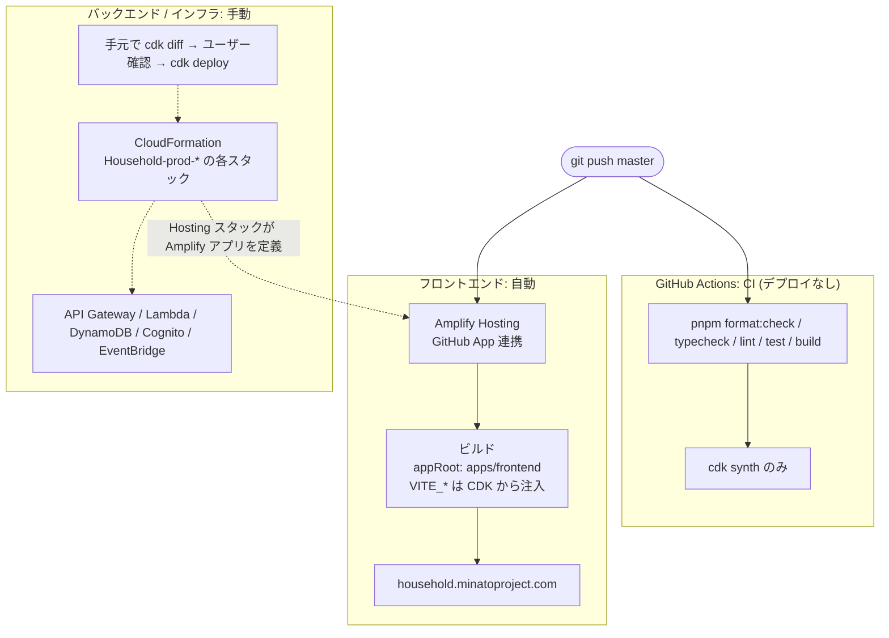

# household-account-book

## Description

個人・家族向けのシンプルな家計簿Webアプリです。

収入・支出・振替の記録、費目別ピボット、予実差、収支推移などの集計をブラウザから確認できます。AWSサーバーレス構成（Lambda + DynamoDB + Cognito + Amplify Hosting）でランニングコストを最小限に抑えつつ、PC/スマホ両対応のレスポンシブUIを提供します。

## Requirement

- Node.js 22.x
- pnpm 9.15.4（`packageManager`フィールドで固定。グローバルpnpmが古い場合は`npx pnpm@9 <command>`を使用）
- AWS CLI（インフラのデプロイ・確認を行う場合）
- AWS CDK（`infra`ワークスペース経由で利用、グローバルインストール不要）

## Install

```bash
git clone git@github.com:<yourname>/household-account-book.git
cd household-account-book
pnpm install
```

pnpmワークスペース構成のため、ルートで`pnpm install`を実行すると全ワークスペース（frontend / backend / infra / packages/shared）の依存関係が一括でインストールされます。

## Usage

### ローカル開発

#### 1. フロントエンドの環境変数を設定

```bash
cp apps/frontend/.env.example apps/frontend/.env
```

`apps/frontend/.env`に、デプロイ済みのバックエンドAPIエンドポイントとCognito User Pool情報を設定してください（`VITE_API_BASE_URL` / `VITE_COGNITO_USER_POOL_ID` / `VITE_COGNITO_CLIENT_ID`）。値は`infra`のCDKスタック（`Household-<stage>-Auth` / `Household-<stage>-Api`）の出力から取得します。

#### 2. フロントエンド開発サーバーの起動

```bash
pnpm --filter @household/frontend dev
```

#### 3. バックエンドのユニットテスト

バックエンドはLambda関数群のため常時起動するローカルサーバーはありません。AWSに接続しないユニットテストで動作確認します。

```bash
pnpm --filter @household/backend test
```

### 横断コマンド

全ワークスペースに対して一括実行できます。

```bash
pnpm -r typecheck
pnpm -r lint
pnpm -r test
pnpm -r build
```

### AWS へのデプロイ

前提: AWS CLIの認証情報が設定済みであること。

#### 1. CDKの差分確認（副作用なし）

```bash
cd infra
pnpm exec cdk synth
pnpm exec cdk diff
```

#### 2. デプロイ

```bash
pnpm exec cdk deploy --all
```

Auth（Cognito）/ Data（DynamoDB）/ Api（API Gateway + Lambda）/ Hosting（Amplify）/ Monitoring（CloudWatch）の5スタックが`Household-<stage>-*`としてデプロイされます。`stage`は`infra/cdk.json`のコンテキストで指定します。

フロントエンドは、GitHub App経由で連携されたAmplify Hostingにより、`master`ブランチへのpushで自動ビルド・デプロイされます。

## Deploy Flow



## Contribution

1. このリポジトリをフォークする
2. 変更を加える
3. 変更をコミットする
4. ブランチにプッシュする
5. プルリクエストを作成する

## License

MIT License

## Author

[minato](https://www.minatoproject.com/)
